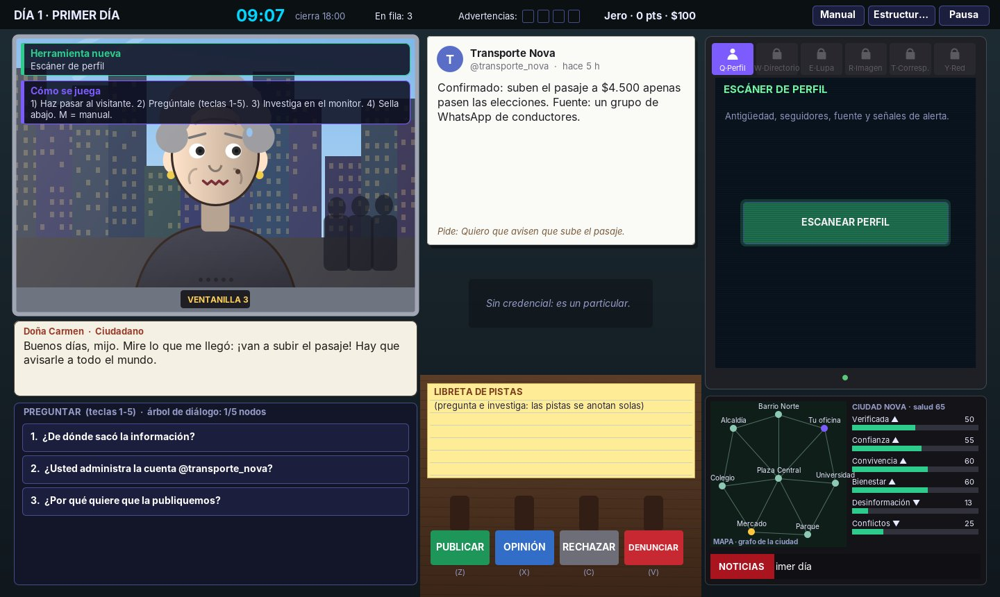

# Influence, Inc.: Mesa de Verificación

Videojuego educativo sobre el **uso responsable de las redes sociales**, inspirado en
juegos de "ventanilla" como *That's Not My Neighbor* y *Papers, Please*.
Universidad del Norte, Estructura de Datos II, 2026.

Es la semana de elecciones en Ciudad Nova y tú eres el nuevo verificador de la agencia
Influence, Inc. La gente hace fila en tu ventanilla para que la agencia publique algo.
Algunos dicen la verdad, otros se creyeron un rumor y otros son **impostores**.
Les preguntas cosas, investigas con las herramientas del computador, los confrontas con
lo que encuentras y **sellas**: PUBLICAR, OPINIÓN, #PUBLICIDAD, RECHAZAR o DENUNCIAR.
Lo que sellas recorre la ciudad, y al final decide cómo se vota.

**Java puro (Swing + Java2D), sin librerías externas.** Las caras se dibujan con código
y el escáner de red usa un motor 3D propio (paquete `motor3d`).



---

## Cómo ejecutarlo

**NetBeans:** `File → Open Project`, elegir esta carpeta y `F6`. La clase principal es
`influenceinc.Main`. Codificación: UTF-8. Es compatible con Java 8 o superior.

**Terminal:**
```bash
javac -d build -encoding UTF-8 $(find src -name "*.java")
java -cp build influenceinc.Main
```

**Pruebas por consola (para la sustentación):**
```bash
java -cp build influenceinc.pruebas.PruebaEstructuras   # grafos + árbol de diálogo + árbol de consecuencias
java -cp build influenceinc.pruebas.PruebaAVL           # AVL del directorio: rotaciones, eliminar, buscar
java -cp build influenceinc.pruebas.PruebaJuego         # 5 días completos x3 estilos, duelo y sockets
```

---

## Cómo se juega

1. **Contesta el teléfono.** Cada mañana llama Don Ramiro, tu jefe: cuenta qué cambió y te da
   herramientas nuevas.
2. **Haz pasar al siguiente** (Espacio). Lee lo que trae (la publicación impresa) y su credencial.
3. **Pregúntale** (teclas 1-5). Las respuestas útiles se anotan solas en la **libreta de pistas**.
4. **Investiga en el monitor.** Cada herramienta gasta minutos del reloj:

   | Tecla | Herramienta | Día | Qué revela |
   |---|---|---|---|
   | Q | Escáner de perfil | 1 | antigüedad, seguidores, fuente, señales de alerta |
   | W | Directorio oficial (AVL) | 2 | si la cuenta es oficial; sugiere la parecida; **K** = llamar |
   | E / L | Lupa | 2 | cara vs. foto de la credencial: busca UN detalle distinto |
   | R | Búsqueda inversa | 3 | si la foto es vieja o de otra ciudad |
   | T | Corresponsal | 3 | va en moto al barrio por la ruta más corta (Dijkstra) |
   | Y | Escáner de red 3D | 4 | quién compartió primero (BFS) y anillos de bots (DFS) |

5. **Confronta.** Cada contradicción que encuentras aparece como pregunta naranja
   **¡CONFRONTAR!** (se *inserta* en el árbol de diálogo). Con dos pruebas, un impostor confiesa.
6. **Sella** (Z X C V B). El noticiero muestra el titular de mañana y la ciudad cambia.
7. A las **18:00** cierra la ventanilla. Errores graves = advertencias; con **4 te despiden**.

| Sello | Cuándo |
|---|---|
| PUBLICAR | Es cierto y está respaldado |
| OPINIÓN | Es un gusto u opinión (el día 5 hay veda electoral y desaparece) |
| #PUBLICIDAD | Le pagan y no lo declara (aparece el día 2) |
| RECHAZAR | Es falso, pero quien lo trae se lo creyó de buena fe |
| DENUNCIAR | Es un impostor o una cuenta falsa |

**M / F1:** manual · **F2:** visor de estructuras (detiene el reloj) · **Esc:** pausa y accesibilidad.

### La historia (5 días, 22 casos)
1. **Primer día:** un rumor del pasaje, un caimán que sí existe y el primer impostor.
2. **El directorio:** alguien se hace pasar por la ingeniera del Acueducto... y luego llega la de verdad.
3. **Las fotos mienten:** fotos viejas, un falso médico y una pizzería suplantada.
4. **La red:** la agencia rival ViralStorm y la cuenta @la_verdad_nova.
5. **Día de elecciones:** hay veda, llueven bulos y al final del día tu jefe llega con un video...

Hay cinco finales: *El sello valiente*, *Ciudad informada*, *Ciudad dividida*,
*Ciudad engañada* y *Despedido*. La pantalla final muestra cómo salió la **elección de alcalde**.

## Modos
| Modo | |
|---|---|
| Solo | La historia completa |
| Duelo en el mismo computador | 2 a 4 jugadores; cada día lo juegan todos por turnos, con los mismos casos y cada uno con su ciudad |
| Red local | Cliente-servidor por sockets TCP (puerto 5077). Misma semilla para todos y marcador en vivo |

## Estructura del código
```
src/influenceinc/
├── estructuras/  ArbolDialogo + NodoDialogo (n-ario), ArbolConsecuencias (n-ario),
│                 ArbolAVLGenerico (directorio), GrafoRed (social), GrafoCiudad (calles)
├── logica/       Historia (casos, llamadas, finales), Jornada (un día), Partida, CiudadEstado,
│                 JugadorVerificador, Caso, BancoPublicaciones
├── modelo/       Persona, Rasgos, Credencial, CuentaOficial, Publicacion, Veredicto, Verdad...
├── motor3d/      Camara (proyección), Escena (algoritmo del pintor + recorte)
├── gui/          OficinaVista (todo el juego), Caras (personas dibujadas), VistaArboles,
│                 VistaRed3D, VentanaPrincipal, PantallaFinal, Sonido, Tema, Iconos
├── red/          ServidorOficina, ClienteOficina
└── pruebas/      PruebaEstructuras, PruebaAVL, PruebaJuego
```

La guía para la sustentación está en [`docs/SUSTENTACION.md`](docs/SUSTENTACION.md).
